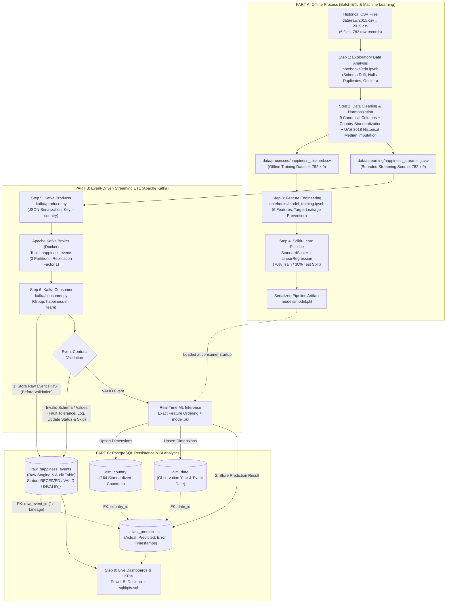
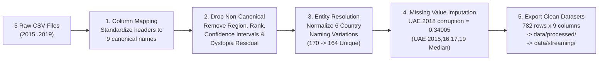
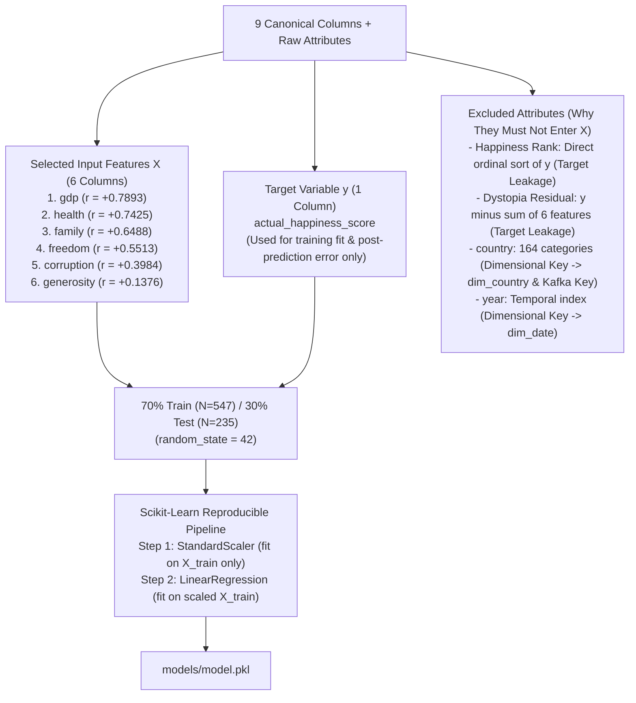
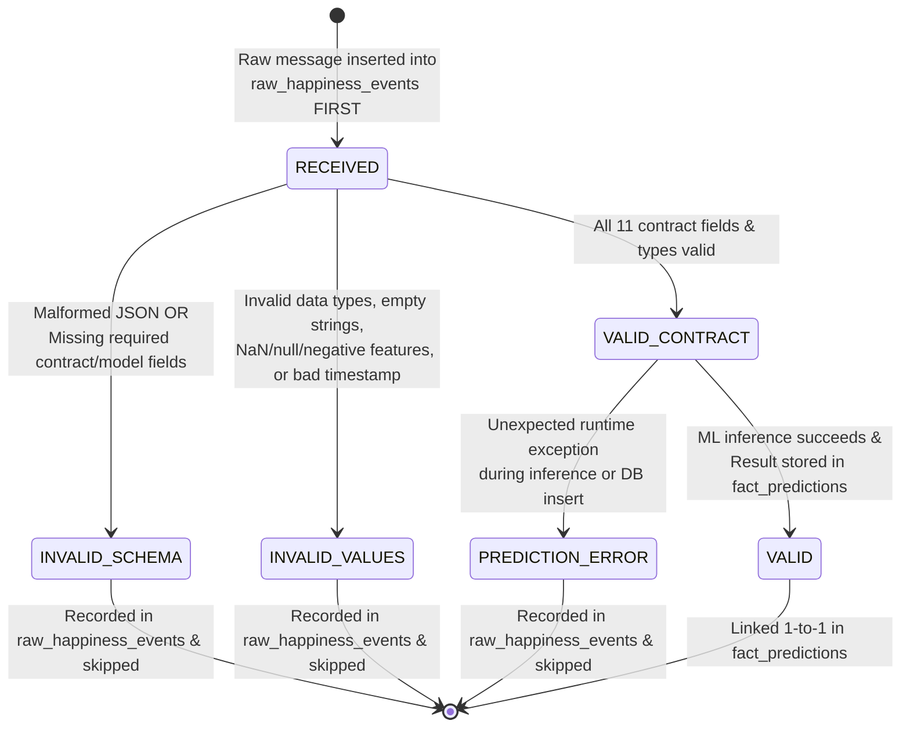
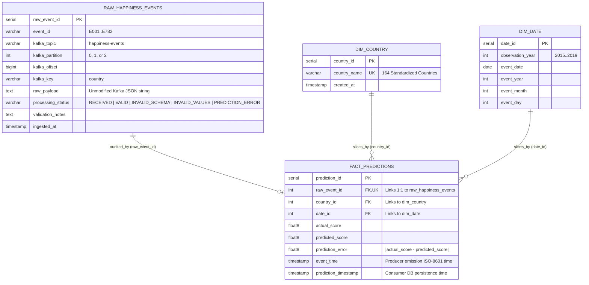
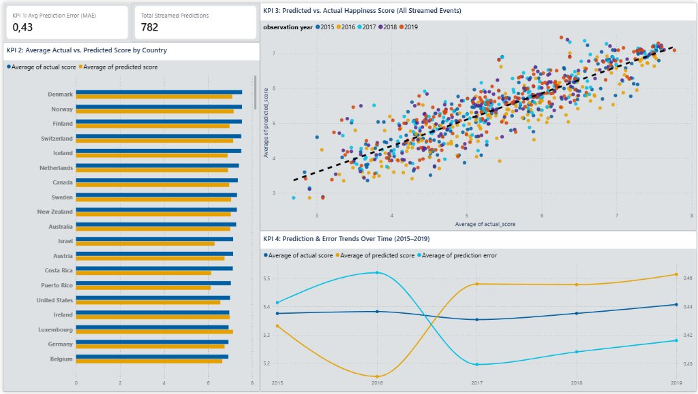
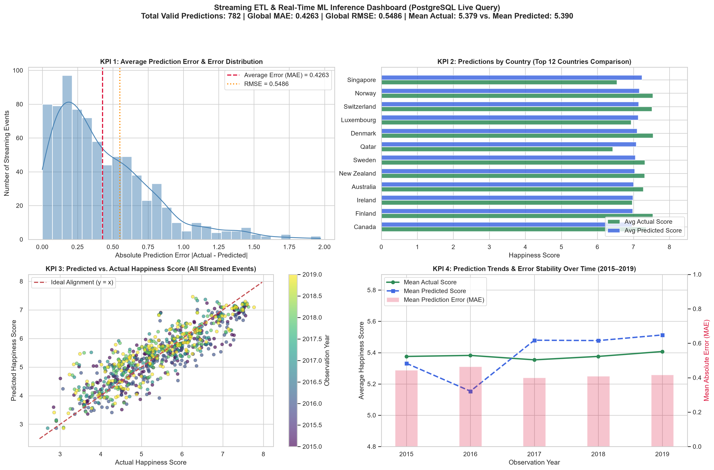

# Workshop-3: Streaming ETL with Apache Kafka and Machine Learning


**Course:** ETL (G01) — Data Engineering and Artificial Intelligence  
**Institution:** Universidad Autónoma de Occidente (UAO)

---

## Table of Contents

1. [Executive Summary (At-a-Glance)](#1-executive-summary-at-a-glance)
2. [Project Overview & End-to-End Architecture](#2-project-overview--end-to-end-architecture)
3. [Repository Structure](#3-repository-structure)
4. [Part A (Steps 1 & 2) — Exploratory Data Analysis, Cleaning & Harmonization](#4-part-a-steps-1--2--exploratory-data-analysis-cleaning--harmonization)
5. [Part A (Steps 3 & 4) — Feature Engineering, Leakage Prevention & ML Pipeline](#5-part-a-steps-3--4--feature-engineering-leakage-prevention--ml-pipeline)
6. [Part B (Steps 5 & 6) — Event-Driven Streaming with Apache Kafka](#6-part-b-steps-5--6--event-driven-streaming-with-apache-kafka)
7. [Part C (Steps 7 & 8) — PostgreSQL Star Schema & End-to-End Traceability](#7-part-c-steps-7--8--postgresql-star-schema--end-to-end-traceability)
8. [Part C (Step 9) — Live PostgreSQL KPIs & Power BI Dashboard](#8-part-c-step-9--live-postgresql-kpis--power-bi-dashboard)
9. [Engineering Design Rationale & Architectural FAQ](#9-engineering-design-rationale--architectural-faq)
10. [Step-by-Step Execution Guide](#10-step-by-step-execution-guide)

---

## 1. Executive Summary (At-a-Glance)

| Pipeline Stage | Core Deliverable | What Was Done & Why | Key Output / Metric |
| :--- | :--- | :--- | :--- |
| **Part A — Step 1** | [`notebooks/eda.ipynb`](notebooks/eda.ipynb) | Audited 5 heterogeneous World Happiness CSV files (`2015`–`2019`), identifying **29 column name variants**, **6 country naming shifts**, **1 missing value**, and **IQR outlier distributions**. | Formal Data Quality Report & **9-Column Canonical Schema Proposal** |
| **Part A — Step 2** | [`notebooks/eda.ipynb`](notebooks/eda.ipynb) | Standardized column names/types across all 5 years, normalized the 6 country names, and imputed the single missing value (`UAE 2018 corruption`) using UAE's historical median (`0.34005`). | **782 clean records** across **164 countries** exported to `data/processed/` and `data/streaming/` |
| **Part A — Step 3** | [`notebooks/model_training.ipynb`](notebooks/model_training.ipynb) | Analyzed Pearson correlations and bivariate regressions, selected the **6 macroeconomic drivers**, excluded leaking features (`Happiness Rank`, `Dystopia Residual`), and configured `StandardScaler`. | Reproducible preprocessing contract with **0 target leakage** and **0 data snooping** |
| **Part A — Step 4** | [`models/model.pkl`](models/model.pkl) | Trained a unified `scikit-learn` `Pipeline` (`StandardScaler` + `LinearRegression`) on a **70% Train (`547`) / 30% Test (`235`)** split and serialized the full pipeline. | Unseen Test Set: **$R^2 = 0.7263$**, **$\text{MAE} = 0.4488$**, **$\text{RMSE} = 0.5846$** |
| **Part B — Step 5** | [`kafka/producer.py`](kafka/producer.py) | Built an event producer that streams historical records one by one as JSON messages to Apache Kafka using `country` as the deterministic partition key. | Topic `happiness-events` (**3 partitions**, **replication factor 1**) |
| **Part B — Step 6** | [`kafka/consumer.py`](kafka/consumer.py) | Built a real-time consumer (`happiness-ml-team`) that stores raw Kafka payloads **before** validation/prediction, validates an 11-field Event Contract, and isolates invalid messages safely. | Fault-tolerant processing: **`782 VALID`**, **`1 INVALID_SCHEMA`**, **`1 INVALID_VALUES`** |
| **Part C — Steps 7–8** | [`sql/create_tables.sql`](sql/create_tables.sql) | Designed a PostgreSQL relational model combining a raw staging table (`raw_happiness_events`), two dimensions (`dim_country`, `dim_date`), and a fact table (`fact_predictions`). | 1-to-1 lineage from every prediction back to the original Kafka payload via `raw_event_id` |
| **Part C — Step 9** | [`sql/kpis.sql`](sql/kpis.sql) & [`dashboards/`](dashboards/) | Wrote direct PostgreSQL analytical queries for the 4 mandatory KPIs and connected **Power BI Desktop** live to PostgreSQL (`localhost:5432`). | Full streaming run (`N=782`): **$\text{MAE} = 0.4263$**, **$\text{RMSE} = 0.5486$** |

---

## 2. Project Overview & End-to-End Architecture

Traditional batch ETL pipelines process static files on a schedule. In contrast, modern production systems require **event-driven streaming pipelines** capable of ingesting continuous events, enforcing strict data contracts, executing low-latency Machine Learning inference, and persisting audit trails alongside analytical star schemas.

This system is architected into **two decoupled environments** connected through a serialized ML artifact (`models/model.pkl`) and a canonical data contract:

1. **Offline Process (Part A — Batch ETL & ML Training)**:
   - Profiles raw multi-year CSV sources (`2015.csv`–`2019.csv`), resolves schema drift, cleans and harmonizes entities, and trains a reproducible `scikit-learn` regression pipeline.
2. **Online Streaming Process (Part B & Part C — Apache Kafka, Real-Time Inference & PostgreSQL)**:
   - Simulates live telemetry arrival by streaming records through **Apache Kafka** (`happiness-events`), persisting every raw message into **PostgreSQL** (`raw_happiness_events`) *prior* to validation, enforcing contract rules with fault tolerance, generating real-time predictions with `models/model.pkl`, and populating an analytical **Star Schema** (`dim_country`, `dim_date`, `fact_predictions`) queried directly by **Power BI**.

### Visual System Architecture



---

## 3. Repository Structure

```text
workshop-3/
├── data/
│   ├── raw/                             # Immutable historical CSVs (2015.csv - 2019.csv)
│   ├── processed/                       # Cleaned dataset for offline ML (happiness_cleaned.csv)
│   └── streaming/                       # Prepared source for Kafka producer (happiness_streaming.csv)
├── notebooks/
│   ├── eda.ipynb                        # Step 1 (EDA) & Step 2 (Data Cleaning & Harmonization)
│   └── model_training.ipynb             # Step 3 (Feature Engineering) & Step 4 (Model Training)
├── kafka/
│   ├── producer.py                      # Step 5: Simulated streaming producer (JSON, key = country)
│   └── consumer.py                      # Step 6 & 8: Consumer, contract validator, inference & DB loader
├── models/
│   └── model.pkl                        # Serialized scikit-learn Pipeline (StandardScaler + LinearRegression)
├── sql/
│   ├── create_tables.sql                # Step 7: PostgreSQL DDL (raw_happiness_events, dims, fact_predictions)
│   └── kpis.sql                         # Step 9: Analytical SQL queries for the 4 mandatory KPIs
├── dashboards/
│   ├── happiness_dashboard.pbix         # Power BI Desktop file connected live to PostgreSQL
│   ├── powerbi_dashboard_screenshot.jpg # Power BI Desktop dashboard screenshot
│   ├── streaming_kpis_dashboard.png     # Automated KPI dashboard plot queried from PostgreSQL
│   ├── generate_dashboard.py            # Python script querying PostgreSQL to render KPI plots
│   └── KPI_EXPLANATIONS.md              # Detailed technical interpretation of all 4 KPIs
├── docker-compose.yml                   # Single-broker Kafka + Zookeeper + Kafka-Init + PostgreSQL 16
├── .env.example                         # Environment variables template (copy to .env)
├── .gitignore                           # Protects .env, .venv/, caches, and local study notes
├── requirements.txt                     # Reproducible Python dependencies
└── README.md                            # Comprehensive Project & Presentation Documentation
```

---

## 4. Part A (Steps 1 & 2) — Exploratory Data Analysis, Cleaning & Harmonization

Implemented in [`notebooks/eda.ipynb`](notebooks/eda.ipynb).

### 4.1 Step 1 — Why Raw Files Cannot Be Concatenated Directly (Schema Drift Analysis)

When inspecting `2015.csv` through `2019.csv`, we found that the World Happiness Report changed its column structure **three times** across the five years, resulting in **29 distinct raw column names**:

1. **Era 1 (`2015.csv` & `2016.csv` — 12 and 13 columns)**:
   - Uses descriptive labels with parentheses: `Economy (GDP per Capita)`, `Health (Life Expectancy)`, `Trust (Government Corruption)`.
   - Includes `Region` and `Dystopia Residual`.
   - `2015` reports `Standard Error`, whereas `2016` replaces it with `Lower Confidence Interval` and `Upper Confidence Interval`.
2. **Era 2 (`2017.csv` — 12 columns)**:
   - Drops the `Region` column entirely.
   - Replaces spaces and parentheses with R-style dots: `Happiness.Rank`, `Happiness.Score`, `Economy..GDP.per.Capita.`, `Health..Life.Expectancy.`, `Trust..Government.Corruption.`, `Dystopia.Residual`, `Whisker.high`, `Whisker.low`.
3. **Era 3 (`2018.csv` & `2019.csv` — 9 columns)**:
   - Drops confidence intervals (`Whisker` / `Standard Error`) and drops `Dystopia Residual`.
   - Renames almost every core attribute: `Country` $\rightarrow$ `Country or region`, `Happiness Score` $\rightarrow$ `Score`, `Family` $\rightarrow$ `Social support`, `Health (Life Expectancy)` $\rightarrow$ `Healthy life expectancy`, `Freedom` $\rightarrow$ `Freedom to make life choices`, `Trust (Government Corruption)` $\rightarrow$ `Perceptions of corruption`.

> [!NOTE]
> **What would happen if we ran `pd.concat()` without harmonization?**  
> Pandas would align columns by exact string match, creating a sparse 29-column table filled with thousands of artificial `NaN` values because `Economy (GDP per Capita)`, `Economy..GDP.per.Capita.`, and `GDP per capita` would be treated as three unrelated attributes.

### 4.2 Data Quality Audit Summary Across All 5 Datasets

| Year | Rows | Columns | Missing Cells (`NaN`) | Full-Row Duplicates | Country Duplicates | Key Data Quality Finding |
| :---: | :---: | :---: | :---: | :---: | :---: | :--- |
| **2015** | 158 | 12 | `0` | `0` | `0` | Complete; uses `Standard Error` and `Region`. |
| **2016** | 157 | 13 | `0` | `0` | `0` | Complete; uses `Lower/Upper Confidence Interval`. |
| **2017** | 155 | 12 | `0` | `0` | `0` | Complete; dot-separated names (`Economy..GDP.per.Capita.`). |
| **2018** | 156 | 9 | **`1`** | `0` | `0` | **Row 20 (`United Arab Emirates`) has `Perceptions of corruption = NaN`**. |
| **2019** | 156 | 9 | `0` | `0` | `0` | Complete; 9-column schema matching 2018. |
| **Total** | **782** | **29 unique** | **`1`** | **`0`** | **`0`** | Harmonized into **782 rows × 9 canonical columns** with **0 nulls**. |

### 4.3 Outlier Analysis & The "Exact Zero (`0.0`)" Methodological Baseline

Using the Interquartile Range ($\text{IQR} = Q_3 - Q_1$) rule with fences $[Q_1 - 1.5\times\text{IQR},\; Q_3 + 1.5\times\text{IQR}]$ across all 782 records:

| Canonical Attribute | $Q_1$ (25%) | Median (50%) | $Q_3$ (75%) | IQR | Lower Fence | Upper Fence | IQR Outliers | Exact Zeros (`0.0`) | Engineering Interpretation |
| :--- | :---: | :---: | :---: | :---: | :---: | :---: | :---: | :---: | :--- |
| `actual_happiness_score` | 4.5098 | 5.3220 | 6.1895 | 1.6798 | 1.9901 | 8.7091 | **`0`** | `0` | Symmetric target distribution (`2.693` to `7.769`). |
| `gdp` | 0.6065 | 0.9822 | 1.2362 | 0.6297 | -0.3380 | 2.1807 | **`0`** | `5` | Well-behaved range; 1 baseline `0.0` per year. |
| `family` | 0.8694 | 1.1247 | 1.3273 | 0.4579 | 0.1825 | 2.0141 | **`10` (low)** | `5` | Conflict-affected nations (e.g., Central African Republic, Syria). |
| `health` | 0.4402 | 0.6472 | 0.8080 | 0.3678 | -0.1115 | 1.3597 | **`0`** | `5` | Smooth distribution; 1 baseline `0.0` per year. |
| `freedom` | 0.3098 | 0.4310 | 0.5310 | 0.2212 | -0.0221 | 0.8628 | **`0`** | `5` | Bounded cleanly; 1 baseline `0.0` per year. |
| `generosity` | 0.1300 | 0.2020 | 0.2788 | 0.1488 | -0.0932 | 0.5021 | **`17` (high)** | `5` | Cultural high-donation nations (e.g., Myanmar, Indonesia). |
| `corruption` | 0.0540 | 0.0910 | 0.1560 | 0.1020 | -0.0990 | 0.3091 | **`67` (high)** | `6` | Right-skewed: most nations have low trust (`<0.15`), while Nordic nations, Singapore & Rwanda exceed `0.31`. |

> [!TIP]
> **1. Why are there exactly five `0.0` values in every feature (one per year)?**  
> In the World Happiness Report methodology, feature values are **not** raw dollar amounts or raw years of life. Instead, they measure *how much that factor contributes to a country's score above "Dystopia"* (a hypothetical benchmark country defined each year with the world's lowest observed values). Consequently, whichever country has the world's lowest value for a factor in a given year legitimately has `0.0` added contribution above Dystopia. They are **valid methodological baselines, not missing values**.  
> **2. Why must we keep the IQR outliers in `corruption`, `generosity`, and `family`?**  
> Those records represent real countries (e.g., Denmark, Singapore, Myanmar, Central African Republic), not sensor noise or typos. Removing them from offline training would cause the model to fail or extrapolate poorly when the Kafka producer streams those countries in real time.

### 4.4 Step 2 — Data Cleaning & Harmonization Workflow



#### Summary of Harmonization Rules Implemented in `notebooks/eda.ipynb`:
1. **Standardized 9-Column Canonical Schema**:
   `['country', 'year', 'gdp', 'family', 'health', 'freedom', 'generosity', 'corruption', 'actual_happiness_score']`
2. **Entity Resolution for Country Names (`170` $\rightarrow$ `164` unique countries)**:
   - `Hong Kong S.A.R., China` (2017) $\rightarrow$ `Hong Kong`
   - `Taiwan Province of China` (2017) $\rightarrow$ `Taiwan`
   - `Trinidad & Tobago` (2018–2019) $\rightarrow$ `Trinidad and Tobago`
   - `Northern Cyprus` (2018–2019) $\rightarrow$ `North Cyprus`
   - `North Macedonia` (2019) $\rightarrow$ `Macedonia`
   - `Somaliland Region` (2016) $\rightarrow$ `Somaliland region`
3. **Principled Imputation of `United Arab Emirates` (`2018`, `corruption`)**:
   - UAE's reported corruption scores in the other four years are `0.38583` (2015), `0.35561` (2016), `0.32449` (2017), and `0.18200` (2019).
   - Imputing with the global 2018 median (`0.0910`) would misrepresent UAE as a high-corruption country. Instead, we imputed using **UAE's own historical median (`0.34005`)**, preserving all `782` rows with `0` missing values.

---

## 5. Part A (Steps 3 & 4) — Feature Engineering, Leakage Prevention & ML Pipeline

Implemented in [`notebooks/model_training.ipynb`](notebooks/model_training.ipynb).

### 5.1 Feature Selection & Target Leakage Prevention



### 5.2 Why Each Feature Decision Matters

1. **Why exclude `Dystopia Residual` and `Happiness Rank`? (Preventing Target Leakage)**:
   - In the World Happiness dataset, a country's `Happiness Score` is mathematically equal to the sum of the 6 factors plus `Dystopia Residual`. If `Dystopia Residual` is included in $\mathbf{X}$, a linear regression model simply adds the 6 columns plus the residual and achieves a fake $R^2 \approx 1.00$. In real-time production, however, you do not know the residual before predicting the score!
   - Similarly, `Happiness Rank` (`1, 2, 3...`) is created by sorting `Happiness Score`. Using it as an input feature leaks the answer directly.
2. **Why exclude `country` and `year` from $\mathbf{X}$?**:
   - One-hot encoding `country` (`164` unique values) on `782` rows would create `163` sparse binary columns, causing severe overfitting and failing on any new territory in streaming. Instead, `country` is modeled as the **Kafka partition key** and the **`dim_country` dimension**.
   - `year` (`2015`–`2019`) is a temporal index modeled in **`dim_date`**, not an intrinsic socioeconomic cause of happiness.
3. **Why wrap `StandardScaler` + `LinearRegression` inside a `scikit-learn` `Pipeline`?**:
   - **Prevents Data Snooping Leakage**: `StandardScaler` computes mean $\mu$ and standard deviation $\sigma$ strictly on the 70% training split (`X_train`), never touching the 30% test split (`X_test`).
   - **Prevents Train-Serve Skew in Kafka**: Because `models/model.pkl` contains both the fitted `StandardScaler` and the fitted `LinearRegression`, `kafka/consumer.py` simply passes the raw 6-feature vector to `model_pipeline.predict(features_df)` and the pipeline automatically scales and predicts in a single atomic call.

### 5.3 Feature Correlation & Learned Standardized Weights ($\beta_j$)

| Feature | Raw Mean | Raw Std | Pearson $r$ with Target | Standardized Weight ($\beta_j$) | Relative Importance |
| :--- | :---: | :---: | :---: | :---: | :--- |
| **`gdp`** | `0.9160` | `0.4073` | `+0.7893` | **`+0.5516`** | **#1 Driver** — Strongest linear effect per standard deviation increase. |
| **`family`** | `1.0784` | `0.3295` | `+0.6488` | **`+0.3304`** | **#2 Driver** — Social support provides the second largest independent lift. |
| **`health`** | `0.6124` | `0.2483` | `+0.7425` | **`+0.2789`** | **#3 Driver** — Life expectancy works alongside GDP to anchor well-being. |
| **`freedom`** | `0.4111` | `0.1529` | `+0.5513` | **`+0.1983`** | **#4 Driver** — Personal autonomy contributes significantly beyond wealth. |
| **`corruption`** | `0.1257` | `0.1059` | `+0.3984` | **`+0.0768`** | **#5 Driver** — Institutional trust adds positive resilience. |
| **`generosity`** | `0.2186` | `0.1223` | `+0.1376` | **`+0.0617`** | **#6 Driver** — Modest but positive independent contribution. |

*(Model Intercept $\beta_0 = 5.3787$)*

### 5.4 Model Evaluation Metrics (70% Train / 30% Test Split)

| Pipeline Configuration | Split | Samples ($N$) | MAE $\downarrow$ | RMSE $\downarrow$ | $R^2$ $\uparrow$ | Status |
| :--- | :---: | :---: | :---: | :---: | :---: | :--- |
| **`Pipeline(StandardScaler, LinearRegression)`** | **Train (70%)** | `547` | `0.4070` | `0.5256` | `0.7719` | Fitted reference |
| **`Pipeline(StandardScaler, LinearRegression)`** | **Test (30%)** | `235` | **`0.4488`** | **`0.5846`** | **`0.7263`** | **Exported to `models/model.pkl`** |
| `Pipeline(StandardScaler, RandomForestRegressor)` | Test (30%) | `235` | `0.4368` | `0.5805` | `0.7301` | Benchmark comparison |

---

## 6. Part B (Steps 5 & 6) — Event-Driven Streaming with Apache Kafka

### 6.1 Docker Compose Infrastructure (`docker-compose.yml`)

The local streaming and database infrastructure is orchestrated via [`docker-compose.yml`](docker-compose.yml) with four services:
- **`zookeeper` (`confluentinc/cp-zookeeper:7.6.1`)**: Manages broker coordination on port `2181`.
- **`kafka` (`confluentinc/cp-kafka:7.6.1`)**: Single-broker Apache Kafka instance exposed on `localhost:9092` (host) and `kafka:29092` (internal Docker network).
- **`kafka-init`**: Automated initialization container that waits until the broker is healthy and creates the required topic:
  - **Topic Name**: `happiness-events`
  - **Partitions**: `3`
  - **Replication Factor**: `1`
- **`postgres` (`postgres:16-alpine`)**: Relational database (`happiness_db` on port `5432`) configured via `.env` variables and mounting `./sql:/docker-entrypoint-initdb.d:ro` so [`sql/create_tables.sql`](sql/create_tables.sql) runs automatically on startup.

### 6.2 Real-Time Streaming Sequence & Architecture

```mermaid
sequenceDiagram
    autonumber
    participant CSV as happiness_streaming.csv
    participant PROD as Kafka Producer<br/>(kafka/producer.py)
    participant KAFKA as Kafka Broker<br/>Topic: happiness-events<br/>(3 Partitions, RF=1)
    participant CONS as Kafka Consumer<br/>(kafka/consumer.py)<br/>Group: happiness-ml-team
    participant PG_RAW as PostgreSQL<br/>raw_happiness_events
    participant MODEL as ML Pipeline<br/>(models/model.pkl)
    participant PG_STAR as PostgreSQL Star Schema<br/>(dim_country, dim_date,<br/>fact_predictions)

    loop Sequential Event Emission (configurable --delay)
        CSV->>PROD: Read historical record
        PROD->>PROD: Format 11-field JSON payload (event_id, ISO-8601 event_time)
        PROD->>KAFKA: Publish JSON Event (Kafka Key = country)
        Note over PROD,KAFKA: murmur2(country) % 3 guarantees all events<br/>for the same country land in the same partition
    end

    loop Real-Time Event Processing
        KAFKA->>CONS: Poll message (topic, partition, offset, key, raw JSON)
        CONS->>PG_RAW: 1. IMMEDIATELY INSERT raw message (status = 'RECEIVED')<br/>Returns raw_event_id BEFORE any validation or ML inference
        CONS->>CONS: 2. Validate Event Contract (schema, data types, bounds, NaNs)
        alt Invalid Event (INVALID_SCHEMA or INVALID_VALUES)
            CONS->>PG_RAW: UPDATE status & validation_notes<br/>(Skip prediction & continue loop without crashing)
        else Valid Event (VALID)
            CONS->>MODEL: 3. Order 6 features [gdp, family, health, freedom, generosity, corruption]
            MODEL-->>CONS: Return predicted_score
            CONS->>CONS: Calculate prediction_error = |actual_score - predicted_score|
            CONS->>PG_STAR: 4. Upsert dim_country & dim_date; INSERT into fact_predictions (FK: raw_event_id)
            CONS->>PG_RAW: 5. UPDATE status = 'VALID'
        end
    end
```

### 6.3 Event Contract Definition & Validation Rules

Before any event is allowed to reach `models/model.pkl`, `kafka/consumer.py` validates the payload against the **Event Contract**:

```json
{
  "event_id": "E001",
  "country": "Colombia",
  "year": 2019,
  "gdp": 0.985,
  "family": 1.41,
  "health": 0.841,
  "freedom": 0.47,
  "generosity": 0.099,
  "corruption": 0.034,
  "actual_happiness_score": 6.125,
  "event_time": "2026-11-08T21:48:06"
}
```

| Contract Field | Expected Type | Validation Rule Enforced by `kafka/consumer.py` | Failure Status Assigned |
| :--- | :---: | :--- | :---: |
| *JSON Payload* | `JSON Object` | Must parse via `json.loads()` as a dictionary containing all 11 required keys. | `INVALID_SCHEMA` |
| `event_id` | `string` | Non-empty string after `.strip()`; unique identifier for traceability (`E001`..`E782`). | `INVALID_VALUES` |
| `country` | `string` | Non-empty string after `.strip()`; also used as the Kafka partition key. | `INVALID_VALUES` |
| `year` | `int` | Strict integer (booleans rejected) within plausible range `[1900, 2100]`. | `INVALID_VALUES` |
| `gdp`, `family`, `health`, `freedom`, `generosity`, `corruption` | `float / int` | All 6 model features must be present (`INVALID_SCHEMA` if missing) and must be finite numbers (`not None`, `not NaN`, `not Inf`, `not bool`) in `[0.0, 10.0]`. | `INVALID_SCHEMA` / `INVALID_VALUES` |
| `actual_happiness_score` | `float / int` | Finite positive number (`> 0.0`). **Used strictly for post-prediction evaluation, NEVER as a model input feature.** | `INVALID_VALUES` |
| `event_time` | `string` | Non-empty string parsable via `datetime.fromisoformat()` (valid ISO-8601 timestamp). | `INVALID_VALUES` |

### 6.4 Fault-Tolerant Processing Status State Machine



---

## 7. Part C (Steps 7 & 8) — PostgreSQL Star Schema & End-to-End Traceability

Defined in [`sql/create_tables.sql`](sql/create_tables.sql).

### 7.1 Entity-Relationship Diagram (`erDiagram`)



### 7.2 Why `raw_happiness_events` Is Separate from the Star Schema
- **`raw_happiness_events` is an immutable staging and audit log**, not a dimension. Storing every incoming Kafka payload immediately before validation ensures:
  1. **Zero Data Loss**: Even if a producer sends a corrupted schema or invalid values, the exact payload, partition, and offset are captured for debugging.
  2. **Reprocessability (Replay)**: If transformation rules or ML models are updated in the future, historical raw events can be re-evaluated directly from `raw_happiness_events`.
  3. **End-to-End Lineage**: Every row in `fact_predictions` holds a `UNIQUE NOT NULL` foreign key `raw_event_id` pointing to the exact raw message that produced it.

---

## 8. Part C (Step 9) — Live PostgreSQL KPIs & Power BI Dashboard

All analytical queries are implemented in [`sql/kpis.sql`](sql/kpis.sql) and query **PostgreSQL (`happiness_db`) directly** (never CSV files).

### 8.1 Power BI Desktop Dashboard (`dashboards/happiness_dashboard.pbix`)

Connected directly to PostgreSQL (`localhost:5432`, `happiness_db`):



### 8.2 Automated PostgreSQL KPI Visualization (`dashboards/streaming_kpis_dashboard.png`)

Generated via [`dashboards/generate_dashboard.py`](dashboards/generate_dashboard.py):



### 8.3 Detailed Breakdown of the 4 Mandatory KPIs

1. **KPI 1 — Average Prediction Error**:
   - **SQL Logic**: Aggregates `AVG(prediction_error)` (MAE) and `SQRT(AVG(POWER(actual_score - predicted_score, 2)))` (RMSE) across `fact_predictions`.
   - **Live Result (`N = 782`)**: **$\text{MAE} = 0.4263$**, **$\text{RMSE} = 0.5486$**, Mean Actual = `5.3790`, Mean Predicted = `5.3904`.
2. **KPI 2 — Predictions by Country**:
   - **SQL Logic**: Joins `fact_predictions` with `dim_country` to compute average actual score, average predicted score, and average prediction error per country.
   - **Live Result**: Top countries (`Denmark`, `Norway`, `Finland`, `Switzerland`, `Iceland`, `Netherlands`, `Canada`, `Sweden`) consistently score `> 7.0` in both actual and predicted metrics.
3. **KPI 3 — Predicted vs. Actual Score**:
   - **SQL Logic**: Joins `fact_predictions`, `dim_country`, `dim_date`, and `raw_happiness_events` to compare record-level `actual_score` against `predicted_score` along the $y = x$ identity line.
4. **KPI 4 — Prediction Trends Over Time**:
   - **SQL Logic**: Joins `fact_predictions` with `dim_date` grouped by `observation_year` (`2015`–`2019`) and by streaming arrival window (`DATE_TRUNC('second', event_time)`).
   - **Live Result**: Shows stable error performance across all 5 historical years (`2015 MAE: 0.4429`, `2016 MAE: 0.4639`, `2017 MAE: 0.3995`, `2018 MAE: 0.4083`, `2019 MAE: 0.4163`).

---

## 9. Engineering Design Rationale & Architectural FAQ

This section documents the core architectural justifications behind our implementation:

### Q1: Why use `country` as the Kafka Event Key across 3 partitions?
In Apache Kafka, when a message is published with a key (`key = country`), the producer hashes the key (`murmur2(key) % num_partitions`) to select partition `0`, `1`, or `2`. This guarantees two critical properties:
1. **Per-Entity Ordering**: All historical observations for the same country (e.g., `Colombia` in 2015, 2016, 2017, 2018, 2019) are guaranteed to land in the **exact same partition** and be processed in strict sequence.
2. **Horizontal Scalability**: The `164` countries are distributed across the `3` partitions, allowing up to `3` consumer instances in the `happiness-ml-team` consumer group to process events in parallel.

### Q2: Why is the Kafka topic configured with `replication_factor = 1`?
In Kafka, the replication factor cannot exceed the number of active brokers in the cluster. Because `docker-compose.yml` deploys a lightweight **single-broker** local environment (`KAFKA_BROKER_ID: 1`), `replication_factor = 1` is required.

### Q3: Why store the raw event in `raw_happiness_events` *before* validating or predicting?
If validation or inference were performed in memory *before* writing to the database, any malformed JSON or schema violation could be lost or crash the consumer. By inserting the unmodified payload into `raw_happiness_events` as the very first step (`status = 'RECEIVED'`) and updating its status afterward (`VALID`, `INVALID_SCHEMA`, `INVALID_VALUES`, or `PREDICTION_ERROR`), we guarantee **100% auditability, zero silent data loss, and non-blocking fault tolerance**.

### Q4: Why use PostgreSQL instead of SQLite for streaming analytics?
In a streaming architecture, `kafka/consumer.py` writes continuously to the database while BI tools (such as Power BI Desktop) execute analytical `JOIN` and `GROUP BY` queries concurrently. File-based engines like SQLite suffer from file-level write locks (`database is locked`) under concurrent read/write workloads, whereas **PostgreSQL** provides full MVCC concurrency, strict foreign-key integrity, and native TCP connections for Docker and Power BI.

---

## 10. Step-by-Step Execution Guide

### 10.1 Prerequisites & Environment Configuration
```powershell
# 1. Copy the environment template to .env
Copy-Item .env.example .env

# 2. Create and activate the virtual environment
python -m venv .venv
.\.venv\Scripts\Activate.ps1

# 3. Install Python dependencies
pip install -r requirements.txt
```

### 10.2 Run Offline Notebooks (Part A)
Open and run the Jupyter notebooks in order (outputs, cleaned CSVs, and `models/model.pkl` are already generated):
1. [`notebooks/eda.ipynb`](notebooks/eda.ipynb) $\rightarrow$ generates `data/processed/happiness_cleaned.csv` and `data/streaming/happiness_streaming.csv`.
2. [`notebooks/model_training.ipynb`](notebooks/model_training.ipynb) $\rightarrow$ trains and exports `models/model.pkl`.

### 10.3 Start Docker Compose Infrastructure (Part B & C)
```powershell
docker compose up -d
docker compose ps
```

### 10.4 Run the Kafka Streaming Pipeline
1. **Terminal 1 — Start the Kafka Consumer**:
   ```powershell
   python kafka/consumer.py
   ```
2. **Terminal 2 — Run the Kafka Producer** (use `--inject-invalid` to also emit 2 test invalid events and see fault tolerance in action):
   ```powershell
   python kafka/producer.py --delay 0.01 --inject-invalid
   ```

### 10.5 Execute PostgreSQL KPI Queries & Refresh Dashboard
```powershell
# Run the 4 KPI queries + audit query directly on PostgreSQL
Get-Content sql/kpis.sql | docker exec -i happiness-postgres psql -U postgres -d happiness_db

# Regenerate the automated KPI dashboard image from PostgreSQL
python dashboards/generate_dashboard.py
```
To view or refresh the interactive Power BI report, open [`dashboards/happiness_dashboard.pbix`](dashboards/happiness_dashboard.pbix) in **Power BI Desktop** and click **Refresh**.
