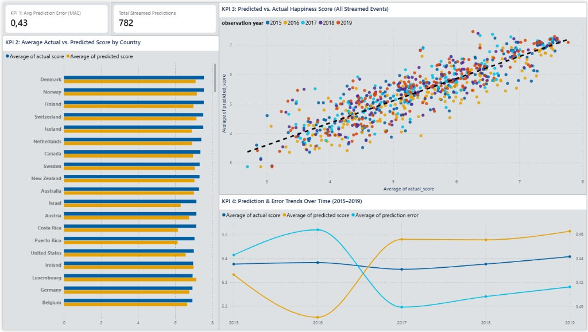

# Dashboard & KPI Explanations (Step 9)

All visualizations and metrics in the dashboard (`happiness_dashboard.pbix`) query the **PostgreSQL** database (`happiness_db` on `localhost:5432`) directly using the star schema (`fact_predictions`, `dim_country`, `dim_date`) and staging audit table (`raw_happiness_events`). No CSV files are queried.

---

## 1. KPI 1 — Average Prediction Error
- **Database Source**: `fact_predictions` (`sql/kpis.sql` — Query 1)
- **Metric Formula**:
  $$\text{MAE} = \frac{1}{N} \sum_{i=1}^{N} |y_i - \hat{y}_i|, \quad \text{RMSE} = \sqrt{\frac{1}{N} \sum_{i=1}^{N} (y_i - \hat{y}_i)^2}$$
- **Result Obtained**:
  - **Total Valid Predictions**: `782`
  - **Global Mean Absolute Error (MAE)**: `0.4263`
  - **Global Root Mean Squared Error (RMSE)**: `0.5486`
- **Analytical Interpretation**: On the 1-to-10 World Happiness scale, the streaming regression pipeline predicts national happiness scores with an average deviation of less than `0.43` points across all `782` streamed country-year events.

---

## 2. KPI 2 — Predictions by Country
- **Database Source**: `fact_predictions` joined with `dim_country` (`sql/kpis.sql` — Query 2)
- **Analytical Purpose**: Compares the mean `actual_score`, mean `predicted_score`, and mean `prediction_error` aggregated across all historical observations for each of the `164` standardized countries.
- **Analytical Interpretation**: Identifies top-tier countries (e.g., Denmark, Norway, Finland, Switzerland, Iceland) and evaluates where the macroeconomic linear model aligns most closely with observed survey scores versus countries where unmodeled cultural or geopolitical factors increase residuals.

---

## 3. KPI 3 — Predicted vs. Actual Score
- **Database Source**: `fact_predictions` joined with `dim_country`, `dim_date`, and `raw_happiness_events` (`sql/kpis.sql` — Query 3)
- **Analytical Purpose**: Plots every streamed prediction (`predicted_score` on Y-axis vs. `actual_score` on X-axis) against the ideal $y = x$ reference diagonal.
- **Analytical Interpretation**: Demonstrates strong linear alignment ($R^2 = 0.7263$ on the unseen test split) across the full spectrum of global happiness scores (`2.69` to `7.77`), with symmetric, homoscedastic error dispersion around the identity line.

---

## 4. KPI 4 — Prediction Trends Over Time
- **Database Source**: `fact_predictions` joined with `dim_date` (`sql/kpis.sql` — Query 4A & 4B)
- **Analytical Purpose**: Tracks the evolution of average `actual_score`, average `predicted_score`, and average `prediction_error` across observation years (`2015` through `2019`) as well as real-time streaming ingestion timestamps (`event_time`).
- **Analytical Interpretation**: Confirms temporal stability of the regression pipeline across all 5 years, with annual MAE remaining stable between `0.3995` (2017) and `0.4639` (2016) and global mean predicted scores (`5.3904`) closely tracking global mean actual scores (`5.3790`).
